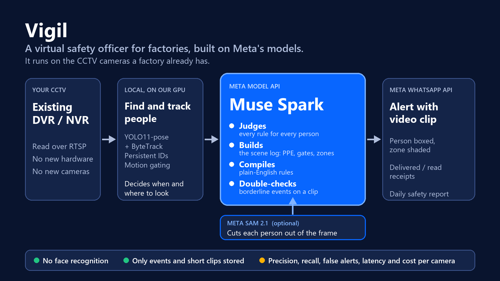
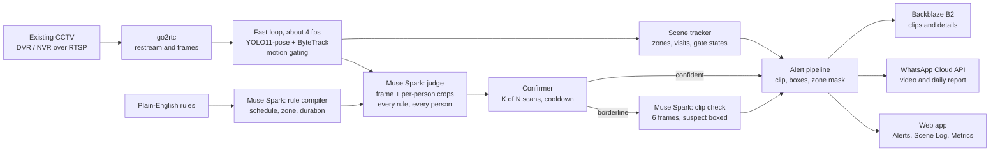

# VIGIL

**A virtual safety and security officer for factories, built on Meta's models and running on the CCTV cameras they already have.**



## Project details

| | |
| --- | --- |
| **What it does** | Turns existing CCTV into a structured scene log (who is in each zone, for how long, in what PPE, and whether gates and exits are open, closed or blocked), enforces safety rules written in plain English, and sends alerts with a video clip to WhatsApp. |
| **Meta models used** | **Muse Spark** (Meta Model API) for judging, the scene log, rule compiling and clip verification. **WhatsApp Cloud API** for alerts, receipts and the daily report. **SAM 2.1** as an optional person cut-out stage. |
| **Runs on** | FastAPI, React, go2rtc, YOLO11-pose + ByteTrack, Backblaze B2, deployed on a Vultr GPU server. |
| **No new hardware** | Connects to the existing DVR/NVR over RTSP. |
| **Privacy** | No face recognition. Alert clips and their details are what VIGIL needs to keep; full-footage recording is optional and can be switched off. |

## Live test

**https://45-76-18-199.sslip.io**

Demo credentials:

```text
Username: admin@regen.com
Password: Admin@123
```

This is a shared demo server running on recorded test footage, not a live factory. WhatsApp alerts raised here go to the team's own test phones, not to you.

What to try:

1. **Alerts**: open an alert and play its clip (the person is boxed, the zone is shaded). Scene alerts are violet; rule alerts are white with a confidence badge.
2. **Safety Rules**: write a rule in plain English and press **Compile rule** to see how Muse Spark understood it (schedule, zone, minimum duration), then **Confirm and use**.
3. **Scene Log**: see who is in each zone and for how long, and press **Play** on a visit to see its clip.
4. **Metrics**: precision, recall, false alerts, alert latency and model cost per camera. Mark alerts real or false on the Alerts page to move these numbers.
5. **Settings**: the **System** tab shows the health of every dependency, and **Detection** changes thresholds with no restart.

## Problem statement

Vigil: a virtual safety and security officer for factories, running on the CCTV cameras they already have.

We have access to a manufacturing factory and our office, where CCTV covers the shop floor, gates and storage, but nobody actually watches it. Safety violations, like workers without helmets near machinery, blocked fire exits, or a gate left open overnight, are only found after an incident or during a manual footage review.

Vigil connects to the existing DVR/NVR over RTSP and turns video into a structured scene log: who is in each zone, for how long, whether they are wearing PPE, and whether gates and exits are open, closed or blocked. The safety officer writes rules in plain English ("alert if anyone is in the press area without a helmet"). Muse Spark compiles each rule into a temporal rule over the log, and checks borderline events on a short clip before alerting, to keep false alarms low.

Alerts go to WhatsApp with a video clip, plus a daily safety report. We report precision, recall, false alerts per camera per day, latency and cost per camera. Motion gating keeps the cost down. There is no face recognition.

## How it works

1. **Connect.** go2rtc registers every camera and restreams it. Nothing is installed on the cameras.
2. **Find and track people (local).** About 4 times a second per camera, YOLO11-pose finds every person and ByteTrack gives each a persistent ID. If nobody is in view and the picture is still, motion gating skips the model call.
3. **Scene log (local).** Zones are drawn on each camera's picture (work areas, gates, fire exits). The scene tracker records a visit when a person's feet enter a zone, and closes it when they leave.
4. **Judge (Muse Spark).** Every few seconds, Muse Spark gets the full frame, a body crop and a head close-up of each tracked person, and all the rules for that camera. It answers one verdict per person per rule with a confidence and a reason. In the same answer it reports each person's PPE (worn, not worn, unclear) and each gate's state.
5. **Confirm.** A violation must show in K of the last N scans (default 2 of 3) with enough confidence (default 60), then stays quiet for a cooldown (default 60 s).
6. **Borderline check (Muse Spark).** If the confidence is under 85, VIGIL cuts the seconds around the event from a rolling camera buffer, takes six frames with only the suspect boxed in red, and asks Muse Spark again. A rejected alert is dropped and counted.
7. **Alert.** The clip is cut, the people are boxed and the zone is shaded, then it is stored in Backblaze B2, saved in the database, shown in the web app, and sent to WhatsApp.

### Architecture



| Part | Where it lives | Job |
| --- | --- | --- |
| Local tracker | `backend/app/detector/tracking.py` | YOLO11-pose + ByteTrack, posture, persistent IDs |
| Judge | `detector/judge.py`, `detector/meta_client.py` | Builds the Muse Spark request, parses one verdict per person per rule |
| Confirmer | `detector/confirm.py` | K-of-N confirmation, cooldown, duplicate suppression |
| Clip check | `detector/verify.py` | Re-judges a borderline alert on six frames of a clip |
| Scene log | `detector/scene.py`, `zones.py`, `scene_api.py` | Zone visits, PPE, gate states, scene alerts |
| Rule compiler | `rule_compiler.py`, `rules_api.py` | Plain English to schedule, zone and duration, confirmed by a person |
| Clips | `clips.py`, `annotate.py`, `violations.py` | Rolling buffer, cutting, boxes and zone mask, upload |
| WhatsApp | `notify.py`, `alerts/`, `whatsapp_webhook.py` | Alerts with video, daily report, delivery receipts |
| Metrics | `metrics.py`, `metrics_api.py` | Precision, recall, false alerts, latency, tokens and cost |
| Storage | `storage.py`, `retention.py` | Backblaze B2, usage, automatic deletion of old files |
| Settings | `settings_store.py`, `settings_api.py`, `system_status.py`, `recorders_api.py` | Live-editable detection values, storage, system health, recorders |
| Web app | `frontend/src/` | React: Overview, Cameras, Alerts, Scene Log, Safety Rules, Metrics, Settings |

## How Meta's models are used

| Meta model | Where | What it does |
| --- | --- | --- |
| **Muse Spark** (`muse-spark-1.3`, Meta Model API) | Judging | Reads the frame plus each person's crops and judges every rule for every person, with a confidence and an explanation. A `checked` list makes it account for everyone. |
| | Scene log | Reports PPE per person and open / closed / blocked per gate, in the same call. |
| | Rule compiler | Turns a plain-English rule (sent as data, never as instructions) into a strictly validated structure: time window, zone, duration. A person confirms it before it is used. |
| | Clip verification | Re-judges borderline events across six frames, where occlusion or a turned head is not a violation. |
| **WhatsApp Cloud API** | Alerts | Video alerts, approved-template fallback outside the 24-hour window, daily report, and delivered / read / failed receipts on each alert. |
| **SAM 2.1** | Optional | Cuts each person out of the frame before judging (`DETECTOR_SEGMENT=1`, off by default). |

## Features

**Safety monitoring**
- Per-person verdicts for every rule, with persistent IDs and one alert per rule that boxes everyone who breaks it.
- Plain-English rules with schedule (also past midnight), zone and minimum-duration enforcement.
- Borderline events re-checked on a short clip before alerting.
- Scene alerts for a person in a marked work area, missing PPE in a zone, a blocked gate or fire exit, and optional overstay. Each has a clip with the zone shaded, shown in violet.

**Alerts**
- Clips with boxes in the web app, filters by camera, group, type and source.
- WhatsApp alerts with video, a daily safety report, and delivery receipts.
- Yes / No review of each alert and a "report a missed event" form.

**Measurement**
- Metrics per camera: precision, recall, false alerts per day, alert latency (p50 and p95), scans, motion-gating savings, borderline checks, tokens and cost.
- Numbers come from the reviews people make. Where there is nothing to calculate them from, the page shows a dash, never an invented zero.

**Operations**
- Settings tabs: Cameras (analysis, clip length, recording length), Recorders (test, edit, delete), Notifications (WhatsApp), Detection (live thresholds), Storage (usage, retention, recording switch), System (health of every dependency, no secrets shown).
- Automatic deletion of old alert clips and recordings after N days (off until you set it), with a preview of what would be deleted.
- Administrator and standard-user accounts, Argon2 passwords, login lockout, optional email password recovery.

## Privacy and data

- **No face recognition.** Nothing in VIGIL identifies anyone.
- **Only what is needed is kept.** Alert clips and their details are stored. Continuous recording of full footage is optional: switch it off under Settings, Storage, and only alert clips and their details are stored.
- **Retention.** Set how many days alert clips and recordings are kept; older ones are deleted for good.
- **Frames leave the server for the model.** VIGIL sends frames and crops of people to Meta's API to judge them. Factories that need this on-premises should plan for that.
- **Secrets stay out of the app.** Keys are only reported as set or not set, WhatsApp numbers are masked, and no password is ever returned by the API.

## Requirements

- Python 3.10 or later
- Node.js `^20.19.0` or `>=22.12.0` and npm (required by Vite 8)
- Docker Desktop with Docker Compose (or a Linux host, see below)
- FFmpeg tools, including `ffprobe`, on your PATH
- A Meta Model API key (Muse Spark) for violation detection
- Network access from the machine running VIGIL to the cameras/DVRs
- Optional: an NVIDIA GPU (the person detector runs much faster on one), a Backblaze B2 bucket for clips, a WhatsApp Business number for alerts

### Install FFmpeg on Windows

```powershell
winget install --id Gyan.FFmpeg.Shared --exact
```

Open a new terminal and check with `ffprobe -version`. If it is not found, add the FFmpeg `bin` directory to your Windows `PATH`.

## Ports

| Service | Default port | Purpose |
| --- | ---: | --- |
| Frontend (Vite) | `5173` | Web application |
| Backend (FastAPI) | `8000` | API |
| go2rtc | `1984` | Stream management API and frames |
| go2rtc | `8554` | RTSP restreaming |
| Cameras/DVRs | Usually `554` | RTSP access; the configured recorder port may differ |

## Setup

Run these commands from the project root in PowerShell. On a Linux server, see [Run on a Linux server](#run-on-a-linux-server).

### 1. Configure `.env`

```powershell
Copy-Item .env.example .env
```

Required:

```text
FERNET_KEY=            # encrypts recorder and camera passwords
JWT_SECRET_KEY=        # signs logins, at least 32 characters
META_API_KEY=          # your Meta Model API key
META_API_URL=https://api.meta.ai/v1
META_MODEL=muse-spark-1.3
```

Generate the two secrets:

```powershell
python -c "from cryptography.fernet import Fernet; print(Fernet.generate_key().decode())"
python -c "import secrets; print(secrets.token_urlsafe(48))"
```

Keep `FERNET_KEY` private and backed up: saved credentials cannot be decrypted if it is lost or changed.

Optional groups, all documented in `.env.example`: Backblaze B2 (`B2_*`) for clips, WhatsApp (`WHATSAPP_*`, `VIGIL_WA_*`), detection tuning (`DETECTOR_*`), scene alerts (`SCENE_*`), the clip check (`DETECTOR_VERIFY*`), a separate rule-compiler key (`COMPILER_API_KEY`), storage retention, and email password recovery (`SMTP_*`).

Many detection and storage values can also be changed on the Settings page without restarting; values changed there win over `.env`.

### 2. Install backend dependencies

```powershell
python -m venv .venv
.\.venv\Scripts\Activate.ps1
python -m pip install --upgrade pip
python -m pip install -r backend\requirements.txt
```

### 3. Start go2rtc

```powershell
docker compose up -d
```

### 4. Start the backend

```powershell
.\.venv\Scripts\python -m uvicorn app.main:app --app-dir backend --reload --host 127.0.0.1 --port 8000
```

API: `http://127.0.0.1:8000`. Interactive docs: `http://127.0.0.1:8000/docs`. The SQLite database is `backend/vigil.db`, created on first start.

### 5. Start the frontend

```powershell
Set-Location frontend
npm install
npm run dev
```

Open the address Vite prints (by default `http://localhost:5173`). It proxies `/api` to the backend.

### Create the first administrator

Run once from the `backend` directory. You will be asked for the password:

```powershell
Set-Location backend
..\.venv\Scripts\python -m app.auth.create_admin --name "Your Name" --email you@company.com
```

The command refuses to run once an administrator exists.

### Run on a Linux server

`start.sh` starts go2rtc, the backend and the frontend (in tmux sessions) and reads `.env`:

```bash
./start.sh            # start everything
./start.sh status     # what is running
./start.sh logs       # last lines of each log
./start.sh restart
```

A bigger person detector finds small or distant people that the bundled `yolo11n-pose` misses. To use it:

```bash
curl -L -o backend/models/yolo11m-pose.pt https://github.com/ultralytics/assets/releases/download/v8.3.0/yolo11m-pose.pt
# then in .env:
#   DETECTOR_POSE_MODEL=/path/to/backend/models/yolo11m-pose.pt
#   DETECTOR_IMGSZ=960
```

To serve over HTTPS (needed for WhatsApp receipts), put a reverse proxy such as Caddy in front of port `5173`, and set `COOKIE_SECURE=true`.

## Authentication

Every API route requires a signed-in user, except `/`, `/health`, the sign-in endpoints under `/api/auth`, and `/api/whatsapp/webhook` (protected by Meta's verify token and request signature). There is no public registration: administrators create accounts under **Users**.

- Passwords are hashed with Argon2. Sessions are JWTs in an HttpOnly, SameSite=Lax cookie (8 hours, or 7 days with "Remember me").
- Logging out, changing a password or disabling a user ends that session immediately.
- After 5 failed sign-ins for an email (or 30 from an IP address), further attempts are blocked for 15 minutes.
- Changing detection settings, deleting old files and editing or deleting recorders need an administrator.

## Supported recorders

Automatic RTSP address generation covers Hikvision, Dahua and CP Plus recorders. Any camera with an RTSP address can be added individually.

## Project structure

```text
backend/
  app/
    detector/          tracking, judge, confirm, verify, scene tracker, worker
    alerts/            WhatsApp Cloud API client and message formatter
    auth/              sign-in, sessions, password recovery, users
    *.py               API routes, clips, storage, retention, metrics, settings
  models/              bundled yolo11n-pose weights
  tools/               detection test script
frontend/src/
  pages/               Overview, Cameras, Alerts, Scene Log, Safety Rules, Metrics, Settings, Users
  components/          page header, zone editor, settings panels
go2rtc/go2rtc.yaml     go2rtc configuration
docker-compose.yml     go2rtc service
start.sh               start / stop / status on a Linux host
docs/architecture.png  architecture diagram
```

## Development checks

From the `frontend` directory:

```powershell
npm run build
npm run lint
```

## Limits and next steps

We would rather say plainly what is not done:

- **Accuracy is not yet measured at scale.** The Metrics page collects precision and recall from real reviews, and we have not yet collected enough to publish figures.
- **Model latency.** A Muse Spark call with a frame and several crops takes roughly 8 to 20 seconds, so alerts are not instant. VIGIL scans asynchronously and only calls the model when people are in view or the picture changes.
- **The person detector can miss small, distant or partly hidden people.** The larger `yolo11m-pose` model helps a lot; a person it never finds cannot be judged.
- **SAM 3.1 and DINOv2** are not used. SAM 2.1 is available as an optional stage and is off by default.
- **WhatsApp** messages reach people outside the 24-hour window only through templates that Meta has approved.
- **Zones are drawn by hand** on each camera, and rules about objects or states (a missing helmet, a closed door) are judged by the model from the rule's wording; only the schedule, zone and duration are enforced exactly by code.

## Conclusion

Factories already own the cameras; what they lack is someone watching. VIGIL turns that unwatched video into a scene log, enforces safety rules a person can write in a sentence, and sends the supervisor a clip on WhatsApp, with Meta's Muse Spark doing the judging, understanding and double-checking, and a cheap local tracker deciding when and where to look. It adds no hardware, recognises no faces, keeps only the clips that matter, and measures its own precision, recall, false alerts and cost per camera, so a safety team can trust it, tune it, and see what it costs.

## Notes

- Camera streams must be reachable from the VIGIL backend host.
- `ffprobe` validates RTSP streams when adding or configuring cameras.
- Do not commit `.env` or share its Fernet key.
